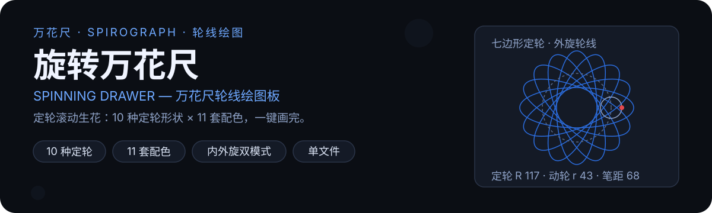
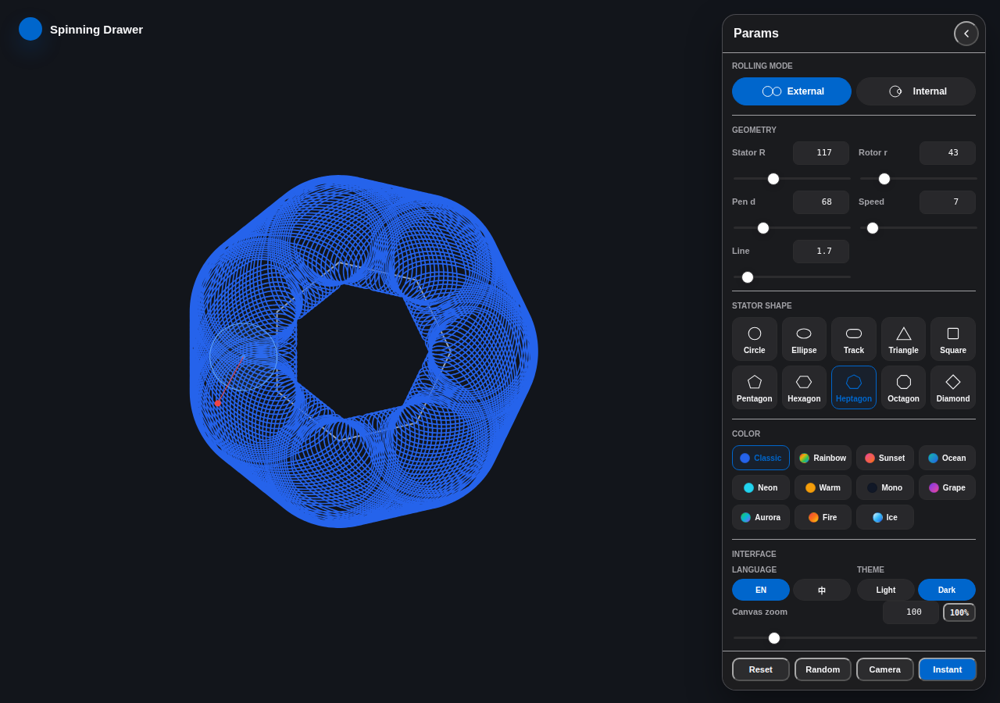

<p align="right"><a href="README.md">中文</a></p>

<p align="center">
  
</p>

<p align="center">
  <a href="https://xiaosang.cc/spinning-drawer/">▶ Try Online</a>
  ·
  <a href="https://holynova.github.io/spinning-drawer/">GitHub Pages Mirror</a>
  ·
  <a href="https://github.com/holynova/spinning-drawer">GitHub Repository</a>
</p>

Spinning Drawer is an interactive Canvas spirograph: a rotor rolls around a stator, and the pen traces epitrochoids and hypotrochoids. Tweak a few parameters to draw intricate symmetric patterns; hit Instant to complete the whole drawing at once. The entire app is a single HTML file — no build, no dependencies.

## Screenshots

<p align="center">
  
</p>

> Screenshot taken locally from the current version (one Instant tap to complete). The three screenshots in `screenshots/` (initial_view / completed_pattern / internal_mode) show the old light UI and are outdated; latest-version.png is a portrait close-up of the current panel — all kept as-is.

## Features

- **Two rolling modes**: 外旋 (External — the rotor rolls outside the stator) and 内旋 (Internal — the rotor rolls inside the stator), switchable with one tap.
- **10 stator shapes**: 圆形 (Circle), 椭圆 (Ellipse), 跑道 (Track), 三角形 (Triangle), 正方形 (Square), 五边形 (Pentagon), 六边形 (Hexagon), 七边形 (Heptagon), 八边形 (Octagon), 菱形 (Diamond).
- **Geometry controls**: stator radius R, rotor radius r, pen offset d, animation speed, and line width — all sliders (defaults R 117 / r 43 / d 68 / speed 7 / line 1.7).
- **11 color palettes**: Classic, Rainbow, Sunset, Ocean, Neon, Warm, Mono, Grape, Aurora, Fire, Ice.
- **Instant** completes the whole drawing at once — no waiting for the animation; **Random** shuffles parameters; **Reset** restores defaults.
- **Pan & zoom**: drag to pan, scroll or use the panel slider to zoom (Canvas zoom, one-click reset to 100%).
- **Share card**: the Camera button generates a card with the project name, artwork, parameter summary, page link, and QR code (QR via the quickchart.io API, needs internet).
- **History**: save the current parameter set to history, click to restore, stored in local browser storage.
- **Interface**: dark floating parameter panel (dark by default, light theme available), English/Chinese toggle, collapsible panel.

## Run Locally

Single-file app — double-click `index.html` to open it directly, or serve it statically:

```bash
python3 -m http.server 8765 --bind 127.0.0.1
# Open http://127.0.0.1:8765/index.html
```

## Tech

- A single `index.html` (~103KB): HTML + CSS + JavaScript all in one, Canvas 2D drawing the trochoids frame by frame; the animation restarts when parameters change.
- Trochoid math: epitrochoids and hypotrochoids are computed live from the stator/rotor radius ratio and pen offset; polygon stators generate vertices by side count, and the rotor rolls along the edges.
- The share-card QR code is generated via the quickchart.io API (the current page URL passed as a URL parameter); everything else runs fully locally.

```
index.html              Everything: UI, styles, trochoid math, Canvas drawing, share card, history
screenshots/            Screenshots: 3 old light-UI shots + 1 current panel close-up
.github/workflows/      Pages deployment
```
