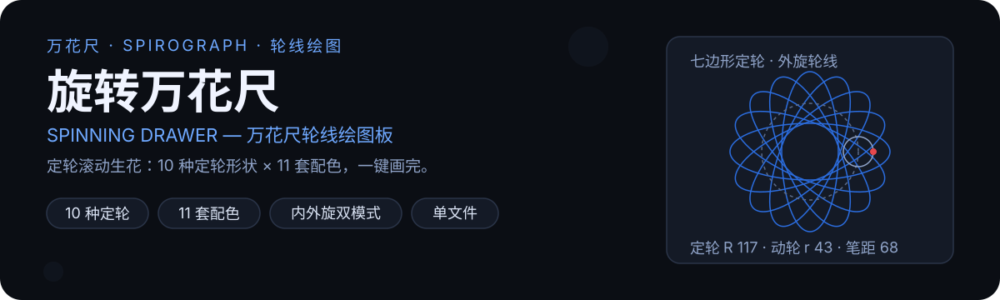
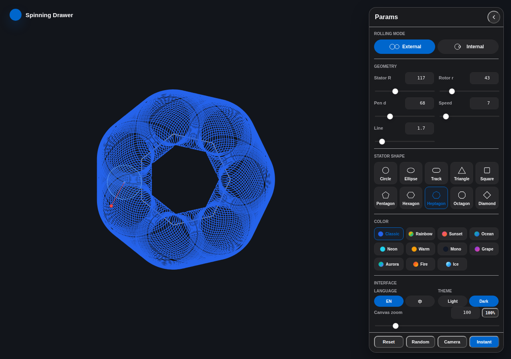

<p align="right"><a href="README.en.md">English</a></p>

<p align="center">
  
</p>

<p align="center">
  <a href="https://xiaosang.cc/spinning-drawer/">▶ 在线体验</a>
  ·
  <a href="https://holynova.github.io/spinning-drawer/">GitHub Pages 镜像</a>
  ·
  <a href="https://github.com/holynova/spinning-drawer">GitHub 仓库</a>
</p>

Spinning Drawer 是一块交互式 Canvas 万花尺绘图板：动轮沿着定轮滚动，笔尖画出外旋轮线（epitrochoid）与内旋轮线（hypotrochoid）。调几个参数，就能画出对称繁复的几何花纹；一键 Instant 瞬间画完整幅图案。整个应用只有一个 HTML 文件，零构建、零依赖。

## 截图

<p align="center">
  
</p>

> 截图为当前版本本地实拍（点 Instant 一键完成）。`screenshots/` 下的 initial_view / completed_pattern / internal_mode 三张是旧版浅色界面的截图，已过时；latest-version.png 是当前面板的竖屏特写，均保留未删。

## 功能

- **内外旋双模式**：外旋（External，动轮在定轮外滚动）与内旋（Internal，动轮在定轮内滚动），一键切换。
- **10 种定轮形状**：圆形、椭圆、跑道、三角形、正方形、五边形、六边形、七边形、八边形、菱形。
- **几何参数**：定轮半径 R、动轮半径 r、笔距 d、动画速度、线宽，全部滑杆可调（默认 R 117 / r 43 / d 68 / 速度 7 / 线宽 1.7）。
- **11 套配色**：Classic、Rainbow、Sunset、Ocean、Neon、Warm、Mono、Grape、Aurora、Fire、Ice。
- **Instant 一键完成**：不用等动画跑完，瞬间画完整幅图案；Random 随机参数，Reset 重置。
- **平移与缩放**：拖动画布平移，滚轮或面板滑杆缩放（Canvas zoom，100% 可一键复位）。
- **分享卡**：Camera 按钮生成分享卡，含项目名、作品图、参数摘要、页面链接与二维码（二维码走 quickchart.io 在线接口，需联网）。
- **历史记录**：保存当前参数组合到历史记录，点击可恢复，存在浏览器本地。
- **界面**：深色悬浮参数面板（默认深色，可切浅色），中英双语切换，面板可折叠收起。

## 本地运行

单文件应用，直接双击 `index.html` 即可打开；或起一个静态服务器：

```bash
python3 -m http.server 8765 --bind 127.0.0.1
# 打开 http://127.0.0.1:8765/index.html
```

## 技术

- 单文件 `index.html`（约 103KB）：HTML + CSS + JavaScript 全在一起，Canvas 2D 逐帧绘制轮线；参数变化时重启动画。
- 轮线数学：外旋轮线与内旋轮线按定轮 / 动轮半径比与笔距实时计算；多边形定轮按边数生成顶点，动轮沿边滚动。
- 分享卡二维码调用 quickchart.io 在线接口生成（URL 参数传当前页面链接），其余功能全部本地运行。

```
index.html              全部：界面、样式、轮线计算、Canvas 绘制、分享卡、历史记录
screenshots/            截图：3 张旧版浅色 UI + 1 张当前面板特写
.github/workflows/      Pages 部署
```
